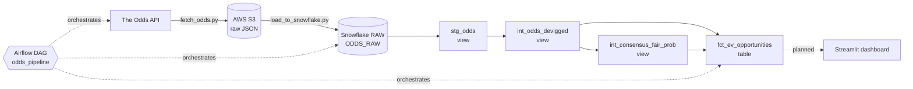

# Architecture

High-level view of the sports betting +EV pipeline as it stands today: what each piece does, how data moves, and why it is built this way.

## The one-sentence version

Every 3 hours, Airflow pulls live NFL odds from The Odds API, lands the raw JSON in S3, loads it into Snowflake, and runs dbt to turn the raw odds into a table of bets where one sportsbook's price is better than the market's fair value.

## Diagram



See [data-flow.md](data-flow.md) for a worked example with real numbers.

Solid arrows are built. Dashed `planned` is not built yet.

## Layers

### 1. Ingestion (`ingestion/fetch_odds.py`)
- Calls The Odds API for NFL head-to-head (moneyline) odds from US books.
- Wraps the response in an envelope (`fetched_at`, `sport`, `event_count`, `events`) so every snapshot is self-describing.
- Writes one JSON file per run to S3: `raw/odds/sport=<sport>/dt=<date>/<timestamp>.json`.
- Raw data is never modified, so any downstream model can be rebuilt from it.

### 2. Raw landing (AWS S3)
Cheap, durable storage for the untouched snapshots. Date-partitioned keys keep it organised.

### 3. Warehouse load (`ingestion/load_to_snowflake.py`, `snowflake/`)
- Lists S3 files, uploads any not yet in the Snowflake internal stage `ODDS_STAGE`, then runs `COPY INTO`.
- Result is `RAW.ODDS_RAW`: one row per snapshot, the JSON in a `VARIANT` column plus `source_file` and `loaded_at`.
- Safe to re-run: files already staged are skipped and `COPY INTO` does not reload files it has seen.

### 4. Transformation (dbt, `dbt/`)
Three layers, each building on the last:

| Layer | Model | Materialized | What it does |
|---|---|---|---|
| Staging | `stg_odds` | view | Flattens the nested JSON (events, bookmakers, markets, outcomes) into one row per outcome per book per snapshot. |
| Intermediate | `int_odds_devigged` | view | Converts American odds to implied probability and decimal odds, measures each book's vig (the margin built into its prices), and removes it to get that book's no-vig `fair_prob`. |
| Intermediate | `int_consensus_fair_prob` | view | Averages `fair_prob` across books per outcome to get the market's `consensus_fair_prob`, and counts how many books contributed. |
| Mart | `fct_ev_opportunities` | table | Compares each book's price to the consensus. `expected_value = consensus_fair_prob * decimal_odds - 1`. Keeps pregame lines with at least `min_books` books and EV at or above `ev_threshold`. Flags the best price per outcome and the latest snapshot. |

Settings in `dbt_project.yml`: `ev_threshold = 0.02` (2%), `min_books = 5`.

**Tests** (31 total): not-null and uniqueness checks in the model YAML files, plus custom SQL tests that de-vigged and consensus probabilities sum to 1, that every mart row meets the EV and book-count thresholds, and that only pregame games appear.

### 5. Orchestration (Airflow, `airflow/`, `docker-compose.yml`)
- Docker Compose runs Postgres (Airflow metadata), the webserver (UI at `localhost:8080`) and the scheduler.
- The `odds_pipeline` DAG runs `fetch_odds` -> `load_to_snowflake` -> `dbt_deps` -> `dbt_run` -> `dbt_test`, every 3 hours (about 240 API credits a month, inside the free 500).
- Python and dbt dependencies live in their own virtualenv in the image so they cannot clash with Airflow's pinned packages.
- If any step fails, the later ones do not run, so bad data never reaches the mart.

## Key concepts

- **Vig (juice):** the margin sportsbooks add so the implied probabilities of all outcomes sum to more than 100%.
- **De-vigging:** dividing each implied probability by that sum, giving a fair probability that sums to exactly 100%.
- **Consensus fair probability:** the average de-vigged probability across books, used as the best estimate of the true chance.
- **+EV:** a bet is positive expected value when a book pays more than the consensus says the outcome is worth.

## Repo layout

```
ingestion/    Python scripts: fetch odds, load to Snowflake
snowflake/    SQL for the raw table, file format, stage and COPY INTO
dbt/          dbt project: staging, intermediate, marts, tests
airflow/      Dockerfile and DAGs
tests/        pytest unit tests for ingestion
Architecture/ this documentation (architecture.md, data-flow.md)
```

## Branching and release flow

Feature branch -> PR into `development` -> PR from `development` into `main`.

## Not built yet

- Streamlit dashboard for current opportunities and historical track record
- GitHub Actions CI (dbt tests, linting)
- Phase 2: real-time ingestion with Kafka and Spark Structured Streaming
- Phase 3: Kubernetes deployment
- Extensions: NBA, arbitrage detection, prediction markets (Polymarket, Kalshi)
